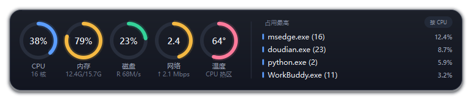
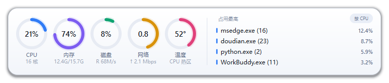

# 悬浮监控栏 · Float HUD

一个常驻桌面的极简系统监控悬浮条。把任务管理器里最常看的那几个数字——CPU、内存、磁盘、网络、温度——压缩成一条随时可见的小面板，同时把"谁在吃掉我的性能"直接摆在眼前。

纯 `QPainter` 手绘，无边框、半透明、可拖动吸附；空闲时零 CPU 占用。





## 界面构成

```
╭─────────────────────────────────────────────────────────────────────────────────╮
│   ◕ 38%     ◕ 79%     ◕ 23%     ◕ 41%     ◕ 64°    │ 占用最高   [按 CPU]        │
│    CPU       内存      磁盘      网络      温度    │ ▌msedge.exe (16)      12.4%│
│   16 核   12.6G/16G    41%     2.4Mbps     64°C    │ ▌doudian.exe (23)      8.7%│
│                                                    │ ▌python.exe (2)        5.9%│
│                                                    │ ▌explorer.exe (3)      2.8%│
╰─────────────────────────────────────────────────────────────────────────────────╯
```

- **左侧环形仪表**：CPU / 内存 / 磁盘活动 / 网络吞吐 / 温度。环内是大号数值，环下是明细（核数、已用÷总量、读写占比、上下行速率、摄氏度）。
- **右侧进程榜**：默认列出整机占用最高的 3 个进程（同名进程自动合并计数），点击标题右侧的小胶囊可在「按 CPU」与「按内存」之间切换。
- **颜色语义**：CPU 蓝、内存紫、磁盘绿、网络橙、温度粉；CPU/内存/磁盘超过 75% 转琥珀、超过 90% 转红，温度则按 **85°C / 75°C** 的摄氏阈值转色。

### 温度环的自适应

温度不是所有机器都能读到。程序启动后先探测一次：

- **读到了** → 显示五枚环，温度随 CPU 负载联动；
- **读不到** → 自动退回四枚环，环组重新居中，不留空位；右键菜单里该项显示为「显示温度（本机读不到）」并置灰；
- 任何时候都可以在右键菜单里手动关闭温度，同样会平滑收回到四枚环。

环形弧度按 **20°C → 100°C** 线性映射。把下限压到 20°C 是为了让冷机（30°C 上下）也有一小段弧，不至于看起来像没启用；环里的读数则始终是真实摄氏值，不受弧度映射截断影响。

## 交互

| 操作 | 效果 |
|---|---|
| 拖动面板 | 移动位置；靠近屏幕边缘会自动吸附 |
| 点击「按 CPU / 按内存」胶囊 | 切换进程榜排序方式 |
| 在进程区滚动滚轮 | 同样是切换排序方式 |
| 悬停进程行 | 高亮该行，并显示进程数 / CPU / 内存的浮层提示 |
| 右键面板 | 深/浅主题、显示条数、刷新频率、显示温度、置顶、复位、退出 |
| 左键单击托盘图标 | 显示 / 隐藏面板 |
| 右键托盘图标 | 同一套菜单 |

所有设置（位置、主题、条数、频率、置顶、排序、是否显示温度）都会写进同目录的 `config.json`，下次启动自动恢复。

## 数据口径

| 指标 | 来源 | 说明 |
|---|---|---|
| CPU | `psutil.cpu_percent()` | 全核平均占用 |
| 内存 | `psutil.virtual_memory()` | 已用 = total − available，与任务管理器一致 |
| 磁盘 | `disk_io_counters().busy_time` 差分 | 折算成"磁盘活动时间占比"，对应任务管理器的磁盘百分比；无 `busy_time` 的平台回退到读写时间 |
| 网络 | `net_io_counters()` 差分 | 字节换算成 Mbps，环形按「好读刻度」自适应缩放（1/2/5/10/20/50…），不会被一次大流量拉满后失真 |
| 温度 | WMI `Win32_PerfFormattedData_Counters_ThermalZoneInformation` | ACPI 热区，字段 `HighPrecisionTemperature`（绝对温度 × 10）。多个热区取最高值 |
| 进程 CPU | `Process.cpu_percent()` 求和 ÷ 逻辑核数 | 换算成"占整机百分比"，与任务管理器同口径 |
| 进程内存 | `Process.memory_info().rss` | 同名进程求和 |

采样在**后台线程**完成（`SamplerThread`）。Windows 上枚举 350+ 进程构造进程榜约需 400–800 ms，若放在主线程会每秒卡顿一次，因此独立线程采样、通过信号回传，UI 线程全程只做绘制。

进程榜用 `process_iter(attrs=[...])` 批量取属性，比逐进程三次系统调用快约一倍。

### 关于温度的两个坑

1. **不能用 `Temperature` 字段**。它和 `HighPrecisionTemperature` 的标度不同，直接除会读出 −243°C 这类荒谬值，必须用 `HighPrecisionTemperature / 10 − 273.15`。
2. **`Win32_TemperatureProbe` 看起来才是"正统"接口，但基本都是空的**（常见是块 LM78A 虚拟探针，所有值都是 32768 = invalid）。真正有数的只有 ACPI 热区。

另外，WMI 走的是 COM，而采样跑在 `QThread` 里，必须在该线程内 `pythoncom.CoInitialize()` / `CoUninitialize()`，否则退出时会刷 `Win32 exception occurred releasing IUnknown`。WMI 查询约 10–20 ms，程序按 3 秒降频，读失败就永久关闭该功能，不反复重试拖慢采样。

## 运行

```bash
pip install -r requirements.txt
python float_hud.py
```

三种启动方式，任选其一：

| 方式 | 说明 |
|---|---|
| **桌面快捷方式** | 双击桌面的「悬浮监控栏」，无黑框、带自定义图标。推荐 |
| `启动悬浮栏.bat` | 双击运行，同样无黑框 |
| `python float_hud.py` | 命令行运行，出错信息直接打在控制台 |

重建桌面快捷方式（换了路径或图标后执行一次）：

```bash
python make_shortcut.py           # 创建
python make_shortcut.py --remove  # 删除
```

- Python 3.10+
- 依赖：`psutil`、`PySide6-Essentials`
- 重建快捷方式额外需要 `pywin32`（`pip install pywin32`），仅在 Windows 上使用
- `启动悬浮栏.bat` 会依次尝试：同目录 venv 的 `..\Scripts\pythonw.exe` → `where pythonw.exe` → `where python.exe`，都没有才提示安装

## 单实例与容错

- **单实例**：用 `QLocalServer` 的本地套接字做互斥，而不是 pid 文件 —— 进程被强杀也不会留下脏锁。重复点击快捷方式不会开出第二个面板，而是把已有面板唤到前台。
- **启动失败不静默**：入口用 `run()` 包住全部逻辑，任何异常都会写 `error.log` 并弹窗提示，不会出现"点了没反应"。Qt 本身没起来时退回 `MessageBoxW`。
- **无 Python 环境**：`启动悬浮栏.bat` 会明确提示安装，而不是一闪而过。

> 踩过的坑：bat 文件必须是 **GBK 编码 + CRLF 换行**，且**不要加 `chcp 65001`**。用 UTF-8 + LF 保存时，cmd 会把 `if exist` 解析成 `xist`，导致所有分支和 `goto` 标签全部失效、脚本静默退出——这正是之前"点了没反应"的真凶。

## 性能说明

- 面板是**纯 QPainter 手绘**，没有嵌套布局和子控件，一帧绘制成本很低。
- 数值变化用 33 ms 的插值动画过渡，动画在数值到位后自动停止，静止时零 CPU 消耗。
- 采样与绘制分离：采样在后台线程按设定频率跑，绘制只在数值变化或鼠标交互时触发。

## 已修复的细节

- 环形弧线起点的圆头凸起 → 光晕层改用平头线帽（`Qt.FlatCap`）
- 环形明细文字被卡片底边裁切 → 实测重算环形块所需高度（96 → 93）
- 行数变化时上下留白不均 → 环形组与进程组各自在内容区垂直居中
- 网络环低速时几乎不动 → 改用「好读刻度」自适应，刻度缓慢回落避免抖动
- `↑8 Mbps` 被渲染成 `10.1 Mbps`（箭头与数字粘连）→ 加空格
- 温度读数被百分制 clamp 截断（真实 27.85° 显示成 30°）→ 摄氏度独立插值
- 温度环在冷机时看着像没启用 → 映射下限降到 20°C
- 采样阻塞 UI → 改为后台线程

## 文件

```
float-hud/
├── float_hud.py        # 全部实现（采样、绘制、交互、托盘、单实例）
├── 启动悬浮栏.bat       # 免黑框启动（GBK + CRLF）
├── make_shortcut.py    # 生成/重建桌面快捷方式
├── app.ico             # 应用图标
├── docs/               # 效果图
│   ├── preview-dark.png
│   ├── preview-light.png
│   └── icon.png
├── requirements.txt
├── LICENSE
└── README.md
```

## 许可

[MIT](LICENSE)
